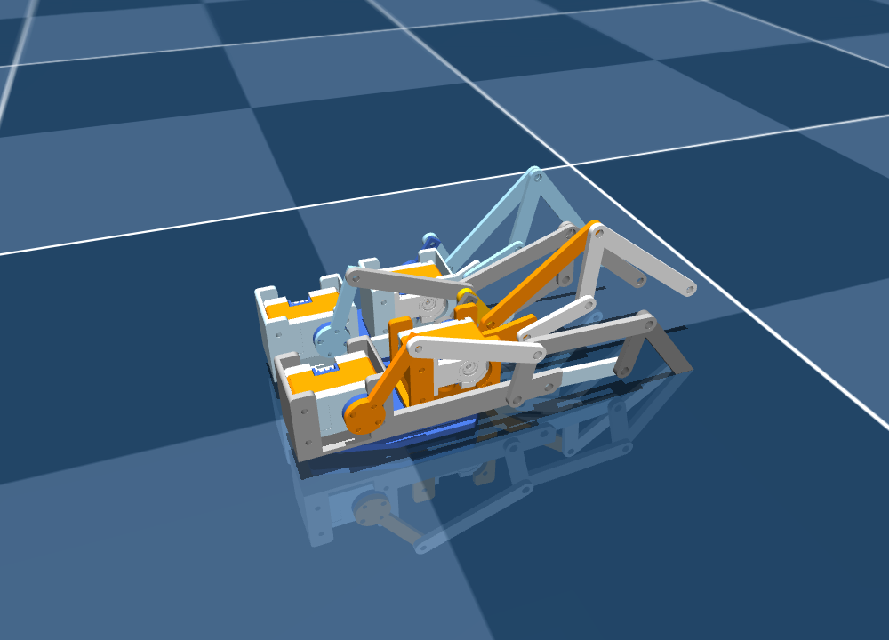

# 手套闭环机构：MuJoCo 控制预览修正版

## 启动

在仓库根目录中，激活已经安装 `mujoco` 和 `numpy` 的环境（例如项目的 `myglove` 环境）：

```bash
conda activate myglove
python3 simulation/glove/view_glove.py
```

- 启动后四根 EF 杆的端点连线与手掌平面平行，初始视角自动居中并拉近；空格切换暂停/运行。
- Backspace 恢复 EF 水平参考姿态及其控制目标；Shift+Tab 显示右侧面板，展开 Control。
- 使用 Control 控制目标角度，单位为弧度。Joint 面板直接改状态，可能暂时破坏闭环，不建议用于检查联动。
- 每根手指只有两个滑块：MCP 外展／内收（名称见下表）和舵盘关节（食指 `j2`、中指 `j10`、无名指 `j26`、小指 `j18`）。
  面板从上到下按食指、中指、无名指、小指排列，每指 MCP 和舵盘控制成对放置。
  四个舵盘滑块统一为左拉展开到水平、右拉扣紧，不能继续向上扬起。
  其余连杆关节没有执行器，是被动关节，通过闭环约束随舵盘关节运动。
- 食指 `j2` 和无名指 `j26` 的执行器 gear 为 -1，显示控制角度与模型关节角度相反；
  中指和小指保持 gear 为 +1。桥接脚本会在两个方向自动换算，标定零点、方向、偏移均保持关节角度含义，
  无需因为调整滑条方向而重新标定。`ef_horizontal` 的控制目标已按执行器顺序和 gear 同步设置。
- 目标角度不一定都能实现，仍受闭环几何和机构奇异位置约束。
- 四指弯曲控制的下界为 EF 水平参考姿态，MCP 外展范围不受这次限制影响。
  这是控制目标范围，不会删除关节或修改连杆几何；直接编辑 Joint 状态仍可能破坏闭环。

也可以使用标准查看器：

```bash
python -m mujoco.viewer --mjcf=simulation/glove/scene.xml
```

## 与实物舵机同步

4 个 XL330 弯曲舵机分别驱动各指连在舵盘上的连杆关节：ID 2 食指 `j2`、ID 3 中指 `j10`、
ID 4 无名指 `j26`、ID 5 小指 `j18`。外展／内收关节没有实物传感器，始终用 sidebar 控制。
实际映射以 `config/servos.json` 为准；重新标定会保留其中的 ID、关节对应关系和方向。

标定时扭矩会被关闭。把四根 EF 杆摆到与手掌平面平行的位置，按 Enter 记录零点，
再把每根手指活动到可用范围并按 Enter 记录限位。显示 `Saved` 后结果写入 `config/servos.json`。
`offset` 自动从模型的 `ef_horizontal` 参考姿态取得，不再沿用旧零姿态留下的偏移。
旧配置不会被预览程序自动重写；使用新参考姿态前需要完成一次这种水平姿态标定：

```bash
python3 scripts/calibration.py
```

然后选择方向启动：

```bash
python3 simulation/glove/servo_bridge.py real2sim   # 扭矩关闭，动实物手指，MuJoCo 跟随
python3 simulation/glove/servo_bridge.py sim2real   # 扭矩开启，拖 sidebar 滑块，舵机跟随
```

- sim2real 启动后先用 1 秒让仿真对齐实物当前姿态，再开始下发；舵机目标直接取 sidebar 滑块值
  （不等仿真动力学），限速 6 rad/s，并限制在标定范围内。关闭窗口时释放扭矩。
- 纯预览从 EF 水平姿态启动；桥接窗口仍会先同步实物当前姿态，不会在启动时自动将电机拉到水平。
- 桥接窗口的弯曲滑条范围是模型允许范围与实物标定范围的交集；sim2real 的实际指令也使用相同限制。
  若启动时实物明显高于水平允许范围，sim2real 会退出并释放其开启的扭矩，不会自动把手指拉回。
  real2sim 不驱动电机，超出该区间的实物读数仍会读取，但仿真控制目标止于水平边界。
- 若某根手指在仿真和实物中方向相反，把 `config/servos.json` 中该舵机的 `direction` 改为 `-1`；
  重新标定会保留已设置的方向。
- 闭环几何会限制可达角度（例如食指 `j2` 从初始姿态正向约 0.13 rad 即卡住），
  超出部分仿真无法跟随；sim2real 下舵机仍按滑块值运动，只受标定范围限制。
- 串口适配器默认 16 ms 延迟会把同步频率限制在约 30 Hz，可设为 1 ms：
  `echo 1 | sudo tee /sys/bus/usb-serial/devices/ttyUSB0/latency_timer`

## 外展／内收关节命名

XML 中的关节名称、驱动器名称及其 joint 引用使用相同名称：

| 原编号 | 手指 | 当前名称 |
| --- | --- | --- |
| j1 | 第2指：食指 | index_mcp_abduction |
| j9 | 第3指：中指 | middle_mcp_abduction |
| j25 | 第4指：无名指 | ring_mcp_abduction |
| j17 | 第5指：小指 | little_mcp_abduction |

这是直接修改 MuJoCo XML，尚未修改 Onshape 的配合名称。
`config.json` 和验证报告保留导出时的原始编号。重新导出会覆盖 XML 中的命名；
若在 Onshape 中使用新名称，需要给配合名称加 `dof_`，并在导出配置中
为这些新名称设置 `actuated: true`（原来的 `j*` 规则不匹配新名称）。
控制脚本的 `FINGER_CONTROLS` 显式列出每根手指的控制器，后续改连杆名称时也应同步更新。

## 修正内容

原 XML 包含 41 个物理 body 元素、40 个 hinge 元素、40 个 actuator 元素。
同一物理连杆沿不同闭环路径重复导出；重复件的网格在初始世界坐标下基本完全重合。

- 保留 25 个实际刚体（不包含 world）；移除 16 个重复 body 元素。
- 保留 24 个唯一树形 hinge 关节；只给 4 个外展关节和 4 个舵盘关节配位置执行器（共 8 个），其余 16 个为被动关节。
- 恢复 8 处闭合旋转连接，每处用两个 connect equality 约束表示，共 16 个 connect。
- 保留原装配的初始网格位姿，不修改 STL 外形。
- 用网格体积及几何恢复近似质量和惯性，替代全部 `1e-9` 占位值。
- 金属螺丝使用 7850 kg/m³；其余网格使用 1250 kg/m³ 作为预览近似。两个非封闭螺丝网格的惯性采用凸包近似。
- 关闭重力和接触，使用隐式积分。这是机构/控制预览，不能用于验证真实重量、驱动力、接触或触觉反馈。
- 配置文件保留原 Assembly 链接。重新运行 onshape-to-robot 会重写手工修正的 XML，因此建议先在 CAD 中完成下述命名修正。

## Onshape 中的对应闭合 Mate

原旋转类型保留，只更改配合名称：

| 当前名称 | 闭合约束名称 |
| --- | --- |
| dof_j4 | closing_j4 |
| dof_j8 | closing_j8 |
| dof_j11 | closing_j11 |
| dof_j16 | closing_j16 |
| dof_j19 | closing_j19 |
| dof_j23 | closing_j23 |
| dof_j27 | closing_j27 |
| dof_j32 | closing_j32 |

其余配合仍使用 dof_，固定配合和 Group 保留。上述选择基于当前 XML 的重复连杆、初始网格位姿及原铰链轴恢复。

闭合连接作为 equality，而非独立 hinge/actuator，因此没有对应的独立 Control 滑块；机构实物连接仍然保留。保留下来的控制器包括：

index_mcp_abduction, j2,
middle_mcp_abduction, j10,
little_mcp_abduction, j18,
ring_mcp_abduction, j26。

各指被动关节：食指 j3, j5, j6, j7；中指 j12, j13, j14, j15；小指 j20, j21, j22, j24；无名指 j28, j29, j30, j31。

## 验证

使用 MuJoCo 3.15.0：模型编译通过；10 秒零输入运行保持初始装配；24 个控制器分别进行 0.3 rad 目标输入测试，没有数值警告（此验证在改为 8 个执行器之前完成；改后仅驱动舵盘关节时，被动连杆跟随的 connect 残差低于 0.05 mm）。基于近似参数的最大 connect 残差低于 0.2 mm。具体结果见 validation.json 和 validation_follow.json。

这组验证不代表任意滑块组合或完整角度范围都已验证；真实动力学仍需材料、质量、碰撞及实际主动/被动关节配置。

## 装配预览


