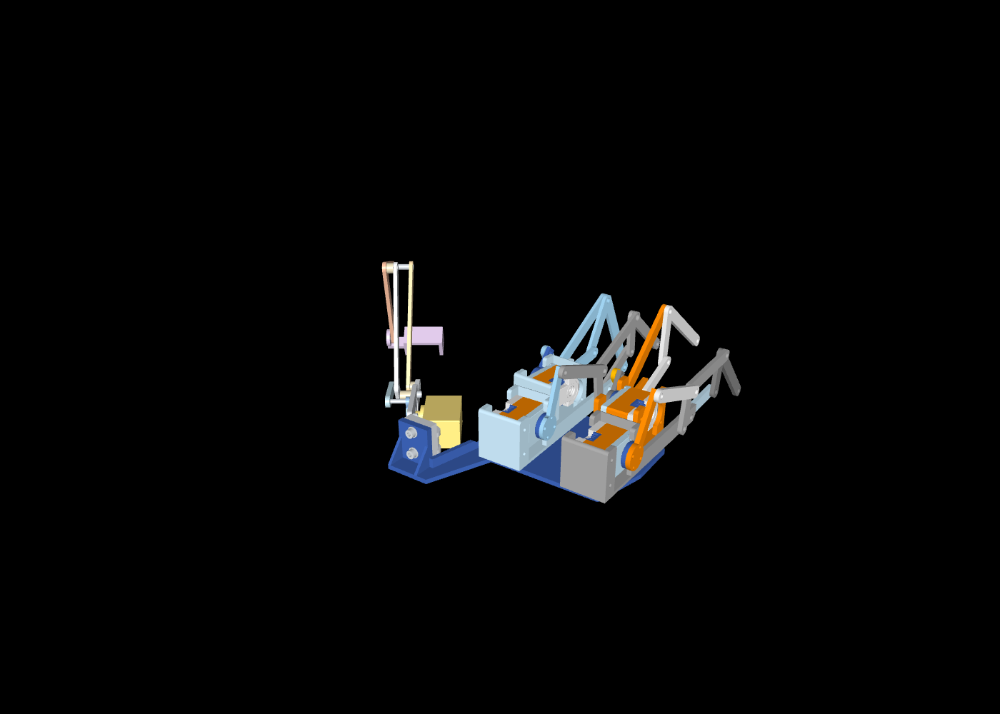

# TeleGlove 五指 MuJoCo 模型

来源：Onshape「五指总装_拇指后移60mm」。已恢复 Assembly 2 的四指配合，并新增拇指 A–H 连杆、掌根铰链、安装座固定和内部刚性分组。所有零件的初始位置与修改前一致。

## 打开带侧栏的 viewer

先激活已安装 MuJoCo 和 NumPy 的环境（例如仓库的 `myglove` 环境），再在本文件夹中运行：

```bash
./run_viewer.sh
```

也可以在仓库根目录运行 `python3 simulation/glove/view_glove.py`。
启动脚本使用当前环境的 `python3`，可通过 `PYTHON` 环境变量指定其他解释器。

两侧面板默认显示。在右侧展开 **Control**，拖动滑块控制。**Shift+Tab** 显示或隐藏右侧面板，**空格**暂停或继续，**Backspace**恢复初始姿态。

- 四指沿用原控制名称。
- `thumb_mcp_abduction`：拇指掌根侧摆。
- `thumb_A`：拇指连杆的默认驱动。
- `thumb_C/D/E/F`：其他连杆控制；同一根手指中最后修改的连杆滑块负责驱动，其余连杆随动。
- `thumb_H`：拇指指端鞍座，独立控制。

31 个滑块对应仿真关节，并不表示 31 台实体电机。此 viewer 不连接真实电机。

## 模型内容与验证

`scene.xml` 为入口，包含 `robot.xml`，必须与 `assets/` 网格一起保留。模型有 32 个刚体、31 个树形关节，以及用 20 个连接约束表示的 10 处闭环转动连接。

五指同时驱动 5 秒的检查通过，无仿真警告；最大闭环误差约 0.055 mm。详细结果见 `validation.json`，源模型和网格对应见 `export_manifest.json`。

`repair_notes.json` 和 `validation_follow.json` 保留此前四指版本的记录；当前五指版本以 `validation.json` 和 `onshape_validation.json` 为准。

`config.json` 记录源装配。当前 XML 已处理闭环和刚性分组，直接运行 onshape-to-robot 会覆盖这些处理；更新模型时应先另行导出并核验闭环，再替换当前文件。

目前用于机构预览：质量和惯量为估算值，关闭重力和碰撞。滑块范围为预览范围，尚未标定实际机械限位；用于动力学或 sim2real 前需进一步标定。


